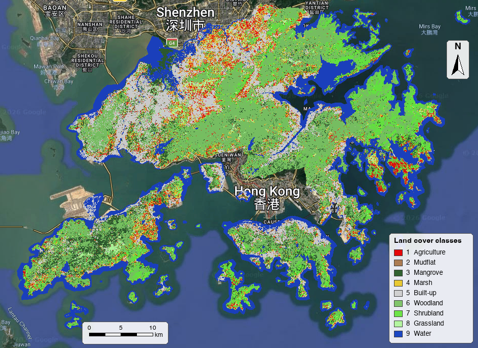

# Mangrove and land-cover classification – Hong Kong

Google Earth Engine script that classifies land cover in Hong Kong for 2021 from Landsat 8 surface-reflectance imagery and a Random Forest classifier, with particular attention to mangroves and other coastal wetland classes.

*9-class Random Forest classification of Hong Kong (Landsat 8, 2021). The scale bar is approximate.*

## Classes

| Class | Label | Colour |
|---|---|---|
| 1 | Agriculture | `#E60909` |
| 2 | Mudflat | `#AC7C52` |
| 3 | Mangrove | `#326332` |
| 4 | Marsh | `#E8C933` |
| 5 | Built-up | `#D0D0D0` |
| 6 | Woodland | `#81C56C` |
| 7 | Shrubland | `#6DE448` |
| 8 | Grassland | `#B4F5A0` |
| 9 | Water | `#1C48C3` |

## Method

[`geeCodeClassificationHK.js`](geeCodeClassificationHK.js) does the following:

1. **Imagery:** Landsat 8 surface reflectance for 2021, clipped to the Hong Kong AOI and reduced to a median composite.
2. **Features:** bands SR_B2–SR_B7 and ST_B10, plus the NDVI, NDMI, NDWI and BSI indices, all rescaled to 0–1.
3. **Classification:** a Random Forest (`smileRandomForest`, 4 trees) trained on labelled polygons. The 9-class run produces the map above.
4. **Accuracy assessment:** a 70/30 training/validation split, giving a confusion matrix and overall accuracy, both exported to Drive as CSV.
5. **Post-processing:**
   - Water comes from the JRC Global Surface Water layer (`occurrence > 0` and `change_abs > -50`).
   - Reservoirs are added as class 10.
   - An elevation threshold of 10 m (DSM) reassigns pixels: woodland, shrubland and grassland at or below 10 m become mangrove, and mangrove, mudflat and marsh above 10 m become shrubland.
   - Tidal ponds are added as class 11.

## Required imports

The script expects these assets to be defined as imports in the Earth Engine Code Editor:

| Variable | Description |
|---|---|
| `aoi` | Hong Kong boundary (FeatureCollection) |
| `surfaceReflectanceL8` | Landsat 8 Collection 2 Level-2 surface reflectance |
| `classes_9`, `classes_8_ag` | Training polygons with a `class` property |
| `global_water` | JRC Global Surface Water |
| `reservoir_tiff` | Reservoir raster |
| `dtm_30` | 30 m DSM image collection (`DSM` band) |
| `tidal_pond` | Tidal pond raster |
