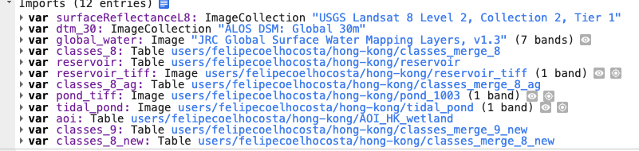

# Mangrove and land-cover classification – Hong Kong

Google Earth Engine script that classifies land cover in Hong Kong for 2021 from Landsat 8 surface-reflectance imagery and a Random Forest classifier, with particular attention to mangroves and other coastal wetland classes.

*9-class Random Forest classification of Hong Kong (Landsat 8, 2021). The scale bar is approximate.*

## Classes

| Class | Label | Colour |
|---|---|---|
| 1 | Agriculture | `#E60909` |
| 2 | Mudflat | `#AC7C52` |
| 3 | Mangrove | `#326332` |
| 4 | Marsh | `#E8C933` |
| 5 | Built-up | `#D0D0D0` |
| 6 | Woodland | `#81C56C` |
| 7 | Shrubland | `#6DE448` |
| 8 | Grassland | `#B4F5A0` |
| 9 | Water | `#1C48C3` |

## Method

[`geeCodeClassificationHK.js`](geeCodeClassificationHK.js) does the following:

1. **Imagery:** Landsat 8 surface reflectance for 2021, clipped to the Hong Kong AOI and reduced to a median composite.
2. **Features:** bands SR_B2–SR_B7 and ST_B10, plus the NDVI, NDMI, NDWI and BSI indices, all rescaled to 0–1.
3. **Classification:** a Random Forest (`smileRandomForest`, 4 trees) trained on labelled polygons. The 9-class run produces the map above.
4. **Accuracy assessment:** a 70/30 training/validation split, giving a confusion matrix and overall accuracy, both exported to Drive as CSV.
5. **Post-processing:**
   - Water comes from the JRC Global Surface Water layer (`occurrence > 0` and `change_abs > -50`).
   - Reservoirs are added as class 10.
   - An elevation threshold of 10 m (DSM) reassigns pixels: woodland, shrubland and grassland at or below 10 m become mangrove, and mangrove, mudflat and marsh above 10 m become shrubland.
   - Tidal ponds are added as class 11.

## Input variables (imports)

The script expects the following 12 imports to be defined at the top of the Earth Engine Code Editor (**Imports** panel). This is how they appear in the original project:

| Variable | Type | Source / asset | Used in script |
|---|---|---|---|
| `surfaceReflectanceL8` | ImageCollection | USGS Landsat 8 Level 2, Collection 2, Tier 1 (`LANDSAT/LC08/C02/T1_L2`) | Yes |
| `dtm_30` | ImageCollection | ALOS DSM: Global 30m (`JAXA/ALOS/AW3D30/V3_2`), `DSM` band | Yes |
| `global_water` | Image | JRC Global Surface Water Mapping Layers, v1.3 (`JRC/GSW1_3/GlobalSurfaceWater`), 7 bands | Yes |
| `aoi` | Table | `users/felipecoelhocosta/hong-kong/AOI_HK_wetland` | Yes |
| `classes_9` | Table | `users/felipecoelhocosta/hong-kong/classes_merge_9_new` | Yes |
| `classes_8_ag` | Table | `users/felipecoelhocosta/hong-kong/classes_merge_8_ag` | Yes |
| `reservoir_tiff` | Image | `users/felipecoelhocosta/hong-kong/reservoir_tiff` (1 band) | Yes |
| `tidal_pond` | Image | `users/felipecoelhocosta/hong-kong/tidal_pond` (1 band) | Yes |
| `pond_tiff` | Image | `users/felipecoelhocosta/hong-kong/pond_1003` (1 band) | Commented-out step only |
| `classes_8` | Table | `users/felipecoelhocosta/hong-kong/classes_merge_8` | No |
| `classes_8_new` | Table | `users/felipecoelhocosta/hong-kong/classes_merge_8_new` | No |
| `reservoir` | Table | `users/felipecoelhocosta/hong-kong/reservoir` | No |

The training tables (`classes_*`) need an integer `class` property that matches the class codes above.

The `users/felipecoelhocosta/...` assets are private Earth Engine assets. To run the script, either ask for access to them or replace them with your own AOI, training polygons and rasters, keeping the same variable names.

## License

This project is released under the [MIT License](LICENSE). Third-party datasets (Landsat, ALOS DSM, JRC Global Surface Water) keep their own terms of use.
